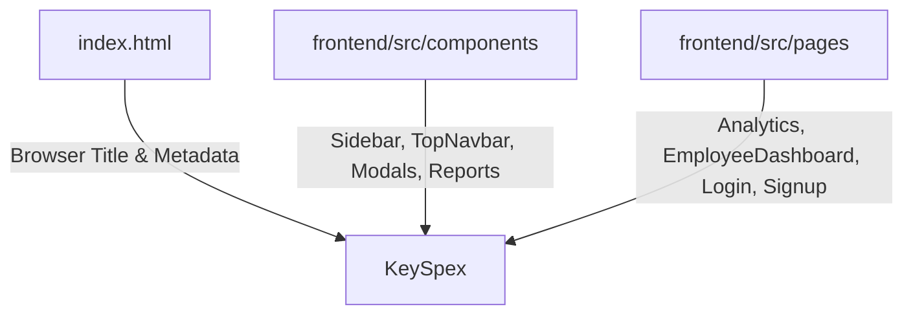

# Rebranding Plan: "SB Gaming Cafe" to "KeySpex"

Rebrand all UI references across `frontend/src/components`, `frontend/src/pages`, and `frontend/index.html` from "SB Gaming Cafe", "SB GAMING", "SB MAX", and "SB" to **"KeySpex"**.

---

## User Review Required

> [!IMPORTANT]
> **1. Brand Name Spelling Confirmation**
> The prompt mentions both *"KeySpecs"* and *"KeySpex"*:
> > *`from " SB Gaming Cafe " to " KeySpecs " ... Replace it with the name " KeySpex "`*
> 
> The project directory is named `keyspex-demo-gaming`. This plan standardizes on **"KeySpex"** across the codebase.
> 
> **2. Coin System Rebranding ("SB Coins" -> "KeySpex Coins")**
> In the components and analytics pages, loyalty coins are displayed to users as "SB Coins" (e.g. `+15 SB Coins`, `Apply SB Coins`, `SB Coins Discount`). This plan updates these customer-facing labels to **"KeySpex Coins"**.
>
> **3. Firebase Environment Credentials (`.env`)**
> `frontend/.env` contains Firebase cloud resource identifiers:
> ```env
> VITE_FIREBASE_AUTH_DOMAIN=sb-gaming-max.firebaseapp.com
> VITE_FIREBASE_PROJECT_ID=sb-gaming-max
> VITE_FIREBASE_STORAGE_BUCKET=sb-gaming-max.firebasestorage.app
> ```
> Changing these strings would immediately break Firebase authentication and Firestore database connectivity, as they point to the actual live Firebase project. **We will preserve `.env` backend connection strings** and only rebrand user-facing UI code.

---

## Proposed Changes



---

### Component Layer (`frontend/src/components`)

#### [MODIFY] `frontend/src/components/dashboard/Sidebar.tsx`
- Replace logo branding text `SB <br /><span className="highlight">Max</span>` with `Key<br /><span className="highlight">Spex</span>`.
- Preserves the existing cyber-yellow dual-color styling (`highlight` class).

#### [MODIFY] `frontend/src/components/dashboard/TopNavbar.tsx`
- Replace `SB GAME MAX` with `KeySpex` inside `<div className="cafe-title">`.

#### [MODIFY] `frontend/src/components/owner/ExportSessionsReport.tsx`
- Update the Excel export title row from `SB GAMING DATABASE [ MONTH ]` to `KEYSPEX DATABASE [ MONTH ]`.

#### [MODIFY] `frontend/src/components/dashboard/SessionEntryModal.tsx`
- Update coin input and discount labels:
  - `<label className="field-label">SB Coins</label>` &rarr; `KeySpex Coins`
  - `{coinsApplied ? "Cancel SB Coins" : "Apply SB Coins"}` &rarr; `"Cancel KeySpex Coins" : "Apply KeySpex Coins"`
  - `⚡ SB Coins Discount:` &rarr; `⚡ KeySpex Coins Discount:`

#### [MODIFY] `frontend/src/components/analytics/BattleHistory.tsx`
- Update reward badge:
  - `<span>+15 SB Coins</span>` &rarr; `<span>+15 KeySpex Coins</span>`

#### [MODIFY] `frontend/src/components/analytics/ThunderCoinsLeaderboard.tsx`
- Update podium label:
  - `SB Coins` &rarr; `KeySpex Coins`

---

### Pages Layer (`frontend/src/pages`)

#### [MODIFY] `frontend/src/pages/Login.tsx`
- **Marquee animated background**:
  ```tsx
  // Before:
  <span>SB</span>
  <span className="stroke-text">MAX</span>
  <span>SB</span>
  <span className="stroke-text">MANAGEMENT</span>

  // After:
  <span>KEY</span>
  <span className="stroke-text">SPEX</span>
  <span>KEY</span>
  <span className="stroke-text">MANAGEMENT</span>
  ```
- **Mobile Header**:
  - `<h2>SB</h2>` &rarr; `<h2>KeySpex</h2>`

#### [MODIFY] `frontend/src/pages/Signup.tsx`
- **Mobile Header**:
  - `<h2>SB</h2>` &rarr; `<h2>KeySpex</h2>`

#### [MODIFY] `frontend/src/pages/EmployeeDashboard.tsx`
- **Footer**:
  - `&copy; 2024 SB Gaming Cafe Management System` &rarr; `&copy; 2024 KeySpex Management System`

#### [MODIFY] `frontend/src/pages/Analytics.tsx`
- **Header**:
  - `<h1>SB <span>Analytics</span></h1>` &rarr; `<h1>KeySpex <span>Analytics</span></h1>`
- **Leaderboard Card Title**:
  - `title="⚡ SB Coins"` &rarr; `title="⚡ KeySpex Coins"`

---

### Root / HTML Entry

#### [MODIFY] `frontend/index.html`
- Update HTML `<title>`:
  - `<title>SB Gaming Cafe</title>` &rarr; `<title>KeySpex</title>`

---

## Verification Plan

### Automated Verification
Run TypeScript type-checking and the production build to ensure zero compilation or syntax errors:
```powershell
npm --prefix frontend run build
```

### Manual Verification
1. Open the web app on `http://localhost:5173`.
2. Inspect the browser tab title: verify it displays "KeySpex".
3. Check **Sidebar**: verify the logo text displays "Key" and highlighted "Spex".
4. Check **TopNavbar**: verify the title bar shows "KeySpex".
5. Check **Login** & **Signup** pages: verify mobile headers and marquee display "KeySpex" instead of "SB MAX".
6. Check **Employee Dashboard** footer: verify it states "KeySpex Management System".
7. Check **Analytics Dashboard**: verify page heading says "KeySpex Analytics" and coin card says "KeySpex Coins".
8. Check **Session Entry Modal**: verify coin labels say "KeySpex Coins".
